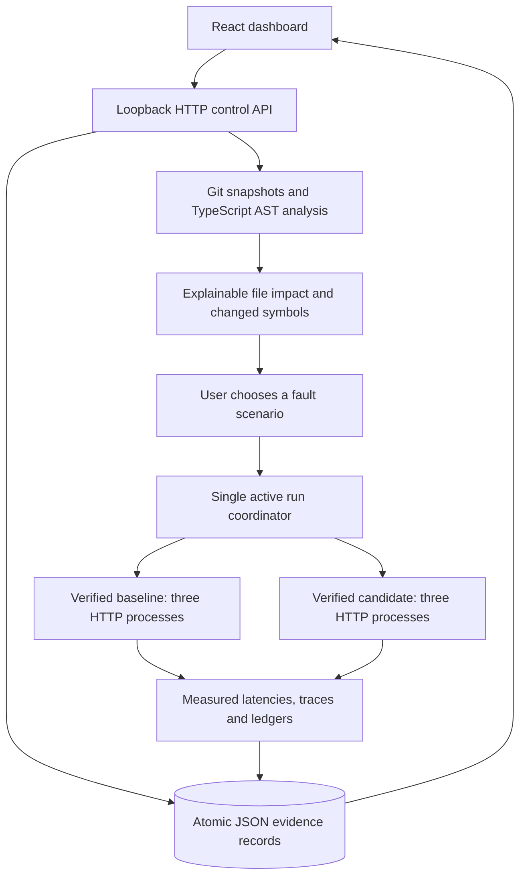

# Flows and architecture

## Analyze
Load the bundled reference repository or enter an existing local repository path and two refs. The API validates input and resolves refs to commits. `WORKTREE` means tracked current working content, not a reproducible commit snapshot, and is labeled accordingly. Analyze tracked source, compute changes, traverse reverse import relationships and show supported evidence. External repositories remain read-only.

## Experiment
Only a bundled baseline/candidate analysis is eligible. Choose one scenario and 5–100 requests per revision. `queued → running → completed | failed | cancelled`; coordinator restart maps unfinished saved states to `interrupted`. A second active experiment is rejected. Cancellation is cooperative; final state follows cleanup.

The runner verifies fixed bundled source before spawning. It starts fresh checkout, inventory and payments services on ephemeral loopback ports for each revision. First-attempt failures are keyed by order ID. Both revisions receive the same order IDs and fault rule. Failure or cancellation closes processes; failed/incomplete runs have no comparison verdict.

## Retry ambiguity
Under lost acknowledgement or latency, payments may record a charge before checkout receives success. Baseline reuses the order idempotency key. The deliberately faulty candidate changes that key per retry. At-least-once requests can therefore create duplicate effects in the candidate. No exactly-once delivery is claimed.

## Evidence
Compare real outcome counts and latencies. Correctness regressions are based on ledger invariants, not inferred solely from timing. Trace entries and counts are exported alongside the original analysis. A passing scenario establishes behavior only for its inputs and environment.
